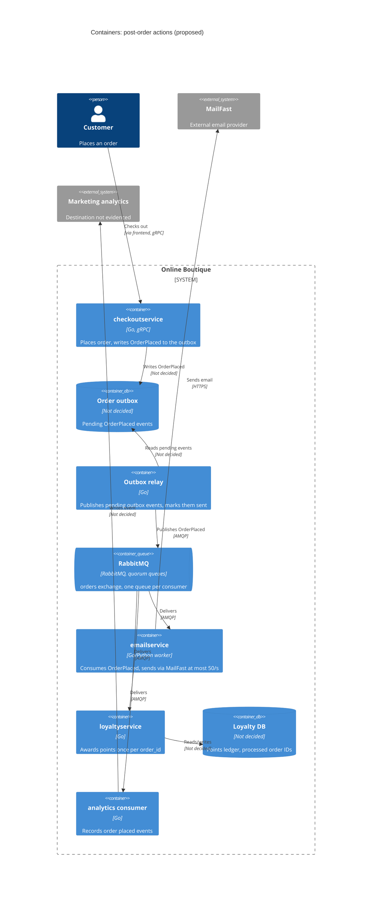

> Author: Pitchanan Thaiphayak (6632151121). Based on an AI draft (`exercise/outputs/2b-adr.md`, Claude Code, Opus 5.5), reviewed and revised by the author.

# ADR-0002: Publish an "OrderPlaced" event to RabbitMQ for post-order actions

- **Status:** Proposed
- **Date:** 2026-10-27
- **Deciders:** Pitchanan Thaiphayak (architect, responsible for reviewing and approving this ADR); Online Boutique development team (4 developers, per `docs/scenario.md`). Business approval is required for the email delay (see Consequences)

## Context and problem

Requirement R-12 (`docs/scenario.md`): after an order is placed, Online Boutique must (1) send the confirmation email through **MailFast**, an external provider that replaces the mock `emailservice` logic, (2) award **loyalty points** through a new `loyaltyservice`, and (3) record an **"order placed" analytics event**. Marketing expects **more post-order actions next year** (SMS, fraud scoring, recommendations update).

**How it works today** (evidence: `system/online-boutique/src/checkoutservice/main.go`):

| Fact | Evidence |
|---|---|
| `PlaceOrder` runs every step in sequence, synchronously over gRPC: cart, catalog and currency (prepare), then `chargeCard`, `shipOrder`, `emptyUserCart`, then `sendOrderConfirmation` | `PlaceOrder` (lines 230-280), `prepareOrderItemsAndShippingQuoteFromCart` (288-311) |
| An email failure is only logged as a warning; the order still succeeds | `PlaceOrder`, `log.Warnf("failed to send order confirmation ...")` (273-277) |
| Each downstream dependency is a gRPC client connection held in the service struct, set from an env var | `checkoutService` struct (66-86), `mustMapEnv(&svc.emailSvcAddr, "EMAIL_SERVICE_ADDR")` (115), `mustConnGRPC` (210-220) |
| Each order gets a unique ID before payment, usable as an idempotency key | `uuid.NewUUID()` (233), `OrderResult.OrderId` (266) |
| `checkoutservice` has no database or persistent store of orders | Not evidenced in the provided files (no store in `checkoutService` struct, 66-86) |
| OpenTelemetry trace context is already propagated | `otel.SetTextMapPropagator(...)` (135-137), `otelgrpc` handlers (139, 216) |

**Forces (from `docs/scenario.md`):**

| Topic | Fact | Consequence for this decision |
|---|---|---|
| Checkout latency | p95 `PlaceOrder` ≤ **500 ms**, today ≈ **300 ms** | Only ≈ 200 ms budget left for new work on the request path |
| MailFast | p95 **1.5 s**, p99 **8 s**, ≈ **0.5 %** failures, limit **50 emails/s** | A synchronous MailFast call alone exceeds the whole latency budget at p95 |
| Peak load | **200 orders/s** (11.11 sale) | 4× the MailFast rate limit: emails *must* be buffered; at peak the backlog grows by 150 emails/s = **9,000 emails per minute of peak** |
| Loyalty | within **1 minute**, **exactly once** | Needs reliable delivery plus duplicate suppression |
| Availability | an order must **never fail** because email, loyalty or analytics is down | These actions must be decoupled from the success of `PlaceOrder` |
| Team | 4 devs, strong Go/gRPC, **two have used RabbitMQ** | Favours a technology the team already knows |
| Operations | Kubernetes; prefer **open-source, self-hosted** | Rules out cloud-only managed brokers as the default |

The problem: **how should `checkoutservice` trigger post-order actions** so that the latency and availability goals hold at 200 orders/s, loyalty points are awarded exactly once within a minute, and new actions can be added next year without changing checkout?

## Decision drivers

1. **Availability:** an order must never fail because email, loyalty, analytics (or a future action) is down.
2. **Performance:** p95 `PlaceOrder` ≤ 500 ms at 200 orders/s, despite MailFast p95 1.5 s / p99 8 s.
3. **Reliability / correctness:** loyalty points awarded exactly once, within 1 minute; emails not silently lost.
4. **Modifiability (extensibility):** adding SMS, fraud scoring and recommendations next year should not require changing `PlaceOrder`.
5. **Throughput shaping:** respect MailFast's 50 emails/s limit while orders arrive at up to 200/s.
6. **Team fit and operations:** Go/gRPC skills, RabbitMQ experience, self-hosted open source on Kubernetes.

## Considered options

1. **Extend the synchronous gRPC chain:** `PlaceOrder` calls MailFast (via a reworked `emailservice`), `loyaltyservice` and an analytics service in sequence, like `sendOrderConfirmation` today.
2. **In-process asynchronous calls:** `PlaceOrder` returns, and goroutines inside `checkoutservice` call email, loyalty and analytics in the background (with in-memory retries).
3. **Event-driven with RabbitMQ (self-hosted):** `PlaceOrder` publishes one `OrderPlaced` event to a fanout/topic exchange; each action has its own durable queue and consumer (`emailservice` → MailFast, `loyaltyservice`, analytics consumer).
4. **Event-driven with a log-based broker (Apache Kafka, self-hosted):** same publish/subscribe shape, using a partitioned, replayable log.

### Pros and cons of the options

| Option | Pros | Cons |
|---|---|---|
| 1. Synchronous gRPC chain | Simplest; matches today's code and the team's gRPC skills; no new infrastructure | MailFast p95 1.5 s alone breaks the 500 ms budget; at 200 orders/s it hits MailFast's 50/s limit; every new action adds latency and a new failure mode to checkout; `checkoutservice` must know every consumer (low modifiability); no retry/backlog, so failed emails/points are lost (today's behaviour: log and forget) |
| 2. In-process async goroutines | Removes MailFast latency from the response; no new infrastructure; easy in Go | Work is lost if a `checkoutservice` pod restarts (in-memory only), so exactly-once loyalty cannot be guaranteed; backlog of 9,000 emails/min of peak would sit in pod memory; rate limiting must be coordinated across replicas; every new action still changes `checkoutservice` |
| 3. RabbitMQ events | Publish is a short in-cluster call, so checkout latency stays low **[Inferred]**, not measured; durable queues absorb the 150/s email surplus and let `emailservice` drain at ≤ 50/s; one queue per consumer isolates failures; new actions = new queue bound to the exchange, no change to checkout (modifiability); two team members know RabbitMQ; open source, runs on Kubernetes | New stateful component to operate (clustering, quorum queues, monitoring); delivery is at-least-once, so `loyaltyservice` must deduplicate; publish happens after payment with no order store, so a crash between charge and publish can lose the event (dual-write problem); no long-term replay of events for analytics by default |
| 4. Kafka events | Same decoupling as option 3; durable, replayable log (good for analytics and future consumers such as recommendations); very high throughput | No one on the team has used it (per scenario); heavier to operate (brokers, partitions, consumer-group rebalancing) for 200 msgs/s; per-message rate limiting and retry/dead-letter handling must be built by hand; same dual-write and at-least-once issues as option 3 |

A managed cloud broker (e.g. a cloud Pub/Sub) was not shortlisted because the company prefers open-source, self-hosted components (`docs/scenario.md`, Operations).

## Decision

Choose **option 3: publish an `OrderPlaced` event to a self-hosted RabbitMQ cluster**, and move all post-order actions to independent consumers. The event is first persisted in a **transactional outbox**, so it cannot be lost between charging the customer and publishing.

Design rules:

- **Checkout (transactional outbox):** after `shipOrder` succeeds, `PlaceOrder` writes one `OrderPlaced` event (order ID from `uuid.NewUUID()`, items, email, totals, trace context) to an outbox table in a new order store, then returns. It does not publish to RabbitMQ directly. The `sendOrderConfirmation` gRPC call and `EMAIL_SERVICE_ADDR` (`main.go` lines 115, 122, 273-277, 379-384) are removed.
- **Outbox relay:** a relay reads pending outbox events, publishes them to RabbitMQ with publisher confirms, and marks them sent only after the confirm. If RabbitMQ is down, events wait in the outbox and the order **still succeeds** (driver 1). The relay may publish an event twice after a crash, which consumers already handle (at-least-once).
- **Email:** `emailservice` becomes a queue consumer calling MailFast with a token-bucket limit of ≤ 50/s, retries with backoff on the ≈ 0.5 % failures, and a dead-letter queue. It replaces the mock logic, as R-12 requires.
- **Loyalty (exactly once):** delivery is at-least-once, so `loyaltyservice` records each processed `order_id` and awards points in the same transaction; duplicates are acknowledged and ignored. Effect: exactly-once *points*, not exactly-once *delivery*.
- **Analytics:** its own queue, so a slow or down analytics sink never delays email or loyalty.
- **Future actions** (SMS, recommendations update): each adds a new queue bound to the same exchange, with no change to `checkoutservice`.
- **Out of scope: fraud scoring.** Fraud decisions may need to happen *before* an order is accepted, unlike the asynchronous post-order actions in this ADR. Fraud scoring needs a separate architecture decision.

Why: it is the only option that meets drivers 1-5 together (option 1 fails performance, availability and rate limit; option 2 fails reliability and exactly-once), and it fits the team better than Kafka (driver 6), as two developers already know RabbitMQ. RabbitMQ is sufficient for the current post-order messaging requirements. **Reconsider Kafka** (option 4) if future requirements make event replay, long-term retention or stream processing important.

## Consequences

- **Positive:** MailFast's 1.5 s / 8 s latency leaves the checkout path; `PlaceOrder` adds only one in-cluster publish to today's ≈ 300 ms **[Inferred]**, to be measured (quality attribute: performance).
- **Positive:** email, loyalty, analytics or MailFast outages no longer affect order success; messages wait in their queue until the consumer recovers (quality attribute: availability, fault isolation).
- **Positive:** the queue absorbs the 200/s vs 50/s mismatch; `emailservice` drains the backlog at MailFast's limit instead of being rejected (quality attribute: scalability / throughput).
- **Positive:** new post-order actions are added by adding consumers, not by editing `checkoutservice` (quality attribute: modifiability).
- **Positive:** each consumer scales on its own queue depth (quality attribute: scalability).
- **Negative:** confirmation emails are no longer immediate; during 11.11 the email backlog grows by ≈ 9,000 per minute of peak and drains at ≤ 50/s afterwards. Total delay depends on peak duration, which is not given (quality attribute: performance as perceived by the customer). **The business must approve this expected delay and define a delivery-time target for confirmation emails** before this ADR is accepted.
- **Negative:** the outbox adds a new order store and a relay to `checkoutservice`, which the team must build and operate (quality attributes: cost, operability).
- **Negative:** RabbitMQ is a new stateful component to deploy, monitor and upgrade on Kubernetes (quality attributes: operability, cost).
- **Negative:** the flow is eventually consistent and harder to trace and debug across services (quality attributes: testability, observability). Partly offset by propagating the existing OpenTelemetry context in message headers (`main.go` lines 135-137) **[Inferred]**.
- **Negative:** consumers must be idempotent and handle duplicates and poison messages (quality attribute: modifiability / development effort).
- **Risks and mitigations:**
  - *Lost event between payment and publish (dual write).* Losing the event after charging the customer would leave the order without a confirmation email or loyalty points. Mitigation (decided): a transactional outbox. The event is persisted in the order store before it is published asynchronously, so a pod crash or a RabbitMQ outage no longer loses it.
  - *RabbitMQ unavailable.* The order must not fail. Mitigation: events wait in the outbox until RabbitMQ recovers; run a 3-node cluster with quorum queues and persistent volumes; alert on publish failures. **[Inferred]**: the cluster size is a typical choice, not a given fact.
  - *Duplicate loyalty points.* Mitigation: dedup on `order_id` inside the loyalty transaction; a test that redelivers the same message.
  - *Loyalty misses the 1-minute target under load.* Mitigation: alert on loyalty queue age; scale `loyaltyservice` replicas. Its required throughput (≥ 200 msgs/s at peak) has not been benchmarked.
  - *Duplicate emails on retry.* A MailFast timeout followed by a retry can send twice. Mitigation: pass `order_id` as an idempotency key if MailFast supports one (not evidenced).
  - *MailFast rate limit exceeded by retries.* Mitigation: retries share the same 50/s token bucket; handle HTTP 429 with backoff.
  - *Team learning curve on RabbitMQ operations.* Mitigation: pair the two experienced developers with the other two; start with a single exchange and simple topology.

## Validation

- **Load test** with the Locust `loadgenerator` (mentioned in ADR-0001) at **200 orders/s**: p95 `PlaceOrder` must be **≤ 500 ms** (target: close to today's ≈ 300 ms).
- **Loyalty lag:** measure time from publish to points awarded; at 200 orders/s, p99 lag must be **< 60 s**. **Duplicate points = 0** after a reconciliation of order IDs against the points ledger, including a test with forced redeliveries.
- **Failure injection:** stop RabbitMQ, `emailservice`, `loyaltyservice`, the analytics consumer and MailFast (mocked) one at a time during the load test; **order success rate must stay 100 %** for orders whose payment and shipping succeed.
- **Email backlog:** during the peak test, MailFast calls stay ≤ 50/s (no 429 storms), the email queue drains fully after the peak, and the dead-letter queue stays near the ≈ 0.5 % failure rate after retries.
- **Extensibility check:** add a dummy "SMS" consumer with no change to `checkoutservice`.
- **Review date:** after the first 11.11 sale using this design. Date not given.

## Open questions

Not given in the provided files; not invented here:

1. **Duration of the 11.11 peak:** needed to size the email backlog (9,000 emails per minute of peak) and the RabbitMQ disk.
2. **Business approval of the confirmation-email delay** during peak, and the delivery-time target. Can MailFast's 50/s limit be raised, or should email be split across providers?
3. **Order store technology for the outbox:** `checkoutservice` keeps no orders today (not evidenced in `main.go`). Which database, and who operates it?
4. **Does MailFast support idempotency keys**, and what API/protocol does it expose (HTTPS assumed in the diagram, not evidenced)?
5. **Analytics sink:** which system does marketing use, and is losing an occasional analytics event acceptable (at-least-once vs best-effort)?
6. **`loyaltyservice` design:** points rules, data store technology, expected throughput.
7. **Who operates RabbitMQ in production** (on-call, backups, upgrades), and is there a budget for the extra cluster resources?
8. **Personal data in events:** the event carries the customer email (`req.Email`, `main.go` line 273). Are there retention or privacy rules for queues?
9. **Do future consumers need event replay** (e.g. recommendations retraining)? If so, revisit option 4 (Kafka) or add a stream/archive.
10. **Fraud scoring:** to be decided in a separate ADR (out of scope here).
