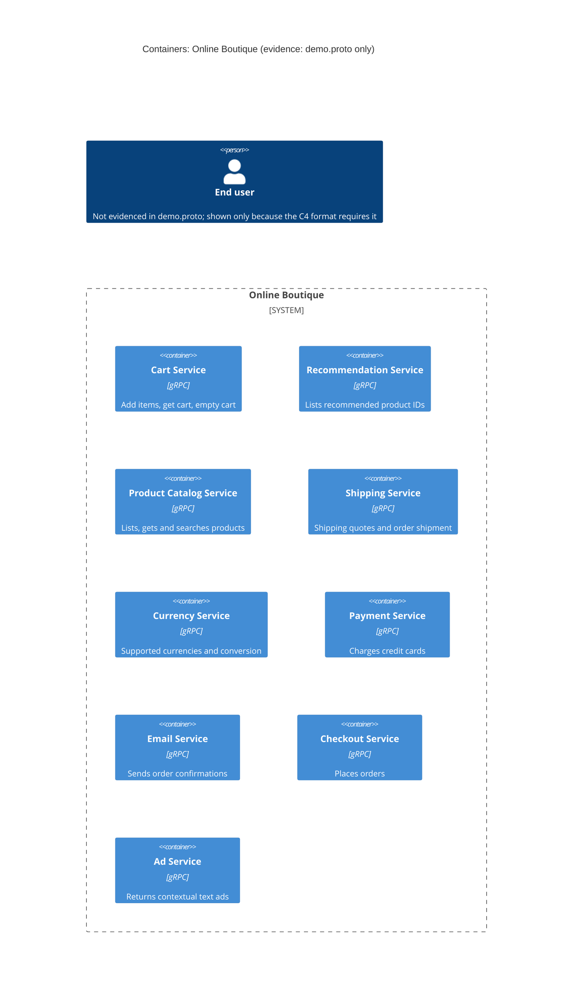

# 1A: Recovered architecture (run A)

## 1. Agent

- Product: Claude Code (Anthropic)
- Model: Opus 5.5 (`claude-opus-5-5`, 1M context)

## 2. Files read

Evidence:

- `system/online-boutique/protos/demo.proto`

Task and rule files (not evidence):

- `AGENTS.md`
- `CLAUDE.md` (loaded automatically by the agent; it only points to `AGENTS.md`)
- `prompts/1-recover-architecture.md`

## 3. Containers table

The evidence is one Protocol Buffers interface file (`syntax = "proto3"`, line 15; `package hipstershop`, line 17). It defines 9 gRPC services. Each service is listed as a container below. **[Inferred]** I am assuming each gRPC `service` is deployed as its own container. The proto defines interfaces only, so it cannot show deployment units.

| Container | Technology / language | Responsibility (from RPCs) | Evidence |
|---|---|---|---|
| Cart Service | gRPC API (proto3). Implementation language: not evidenced | Add items to a user's cart, get a cart, empty a cart (`AddItem`, `GetCart`, `EmptyCart`) | `system/online-boutique/protos/demo.proto` (`service CartService`, lines 23-27) |
| Recommendation Service | gRPC API (proto3). Language: not evidenced | Return recommended product IDs for a user and a list of products (`ListRecommendations`) | `demo.proto` (`service RecommendationService`, lines 56-58) |
| Product Catalog Service | gRPC API (proto3). Language: not evidenced | List products, get one product, search products (`ListProducts`, `GetProduct`, `SearchProducts`) | `demo.proto` (`service ProductCatalogService`, lines 71-75) |
| Shipping Service | gRPC API (proto3). Language: not evidenced | Quote shipping cost for an address and items, ship an order and return a tracking ID (`GetQuote`, `ShipOrder`) | `demo.proto` (`service ShippingService`, lines 107-110) |
| Currency Service | gRPC API (proto3). Language: not evidenced | List supported currencies, convert `Money` to another ISO 4217 currency (`GetSupportedCurrencies`, `Convert`) | `demo.proto` (`service CurrencyService`, lines 140-143) |
| Payment Service | gRPC API (proto3). Language: not evidenced | Charge a credit card for an amount and return a transaction ID (`Charge`) | `demo.proto` (`service PaymentService`, lines 177-179) |
| Email Service | gRPC API (proto3). Language: not evidenced | Send an order confirmation to an email address (`SendOrderConfirmation`) | `demo.proto` (`service EmailService`, lines 199-201) |
| Checkout Service | gRPC API (proto3). Language: not evidenced | Place an order for a user with an address, email, card and currency, and return an `OrderResult` (`PlaceOrder`) | `demo.proto` (`service CheckoutService`, lines 224-226; `PlaceOrderRequest`, lines 228-235) |
| Ad Service | gRPC API (proto3). Language: not evidenced | Return text ads for a set of page context keywords (`GetAds`) | `demo.proto` (`service AdService`, lines 243-245) |

Notes:
- `option go_package = ".../hipstershop"` (line 19) only shows that Go stubs can be generated from this file. It does not show which language any service is written in.
- No data store, message broker, UI/frontend or external system is defined in the evidence.

## 4. Dependencies table

| Caller → callee | Protocol | Evidence |
|---|---|---|
| None evidenced | N/A | `demo.proto` defines server interfaces (`service ... { rpc ... }`) only. It contains no client configuration, service addresses, or caller-to-callee links. |

The message types suggest possible call relationships, but these are not proven runtime dependencies. They are listed under **Gaps** below.

## 5. Mermaid diagram

No dependency is evidenced, so the diagram has no `Rel` lines. That keeps it consistent with the tables. The `Person` is included only because the diagram format requires it. The proto does not show an end user or how one reaches the system.

## 6. Gaps

| Gap | What the evidence does or doesn't show | File that would settle it |
|---|---|---|
| Who calls whom (all runtime dependencies) | Not evidenced in the provided files. **[Inferred]** from message shapes: `PlaceOrderRequest` (lines 228-235) carries `user_id`, `user_currency`, `address`, `email` and `credit_card`. These match the inputs of `CartService.GetCart/EmptyCart`, `CurrencyService.Convert`, `ShippingService.GetQuote/ShipOrder`, `EmailService.SendOrderConfirmation` and `PaymentService.Charge`. `OrderResult` (lines 208-214) is shared by `PlaceOrderResponse` and `SendOrderConfirmationRequest`. So `checkoutservice` may call cart, product catalog, currency, shipping, payment and email. | `system/online-boutique/kubernetes-manifests/*.yaml` (`*_SERVICE_ADDR` env vars), and the service source code |
| Recommendation → Product Catalog | Not evidenced. **[Inferred]** `ListRecommendationsResponse` returns only `product_ids` (lines 65-67), and `Product.categories` is commented as usable "to look up other related products" (lines 84-86). | `kubernetes-manifests/recommendationservice.yaml` or the recommendation service source |
| Frontend / web UI and how the end user reaches the system | Not evidenced. No frontend service is defined in the proto. Its protocol (HTTP?) and whether it exists at all are unknown. | `kubernetes-manifests/frontend.yaml` and the frontend source |
| Data stores (e.g. cart storage) | Not evidenced. **[Inferred]** `Cart` is keyed by `user_id` (lines 47-50), so cart state must be stored somewhere. Where and how is unknown. | `kubernetes-manifests/cartservice.yaml` (and any data store manifest), cart service source |
| Product catalog data source | Not evidenced (file, DB, or in-memory?) | Product catalog service source / manifest |
| External systems (payment provider, mail server, currency rates source) | Not evidenced. The RPCs suggest these could exist, but the proto gives no external endpoints. | Payment, email and currency service sources and manifests |
| Implementation language of each service | Not evidenced (`go_package`, line 19, applies to generated stubs only) | Each service's `Dockerfile` or source folder |
| Deployment unit per service, ports, replicas | Not evidenced (one container per `service` is **[Inferred]**) | `system/online-boutique/kubernetes-manifests/` |
| Async messaging / brokers | Not evidenced. Every interface is a unary gRPC RPC. | Manifests and source code |
