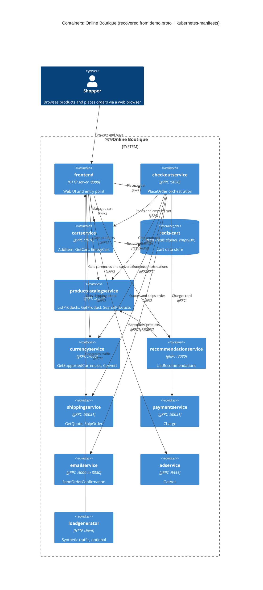

# 1B – Recovered C4 container architecture: Online Boutique

Run: **B** · Evidence: `system/online-boutique/protos/demo.proto`, `system/online-boutique/kubernetes-manifests/`

## 1. Agent

Claude Code (Anthropic CLI agent), model **Claude Opus 5.5** (`claude-opus-5-5[1m]`).

## 2. Files read

| # | File |
|---|------|
| 1 | `AGENTS.md` (repo rules) |
| 2 | `prompts/1-recover-architecture.md` (task file) |
| 3 | `system/online-boutique/protos/demo.proto` |
| 4 | `system/online-boutique/kubernetes-manifests/kustomization.yaml` |
| 5 | `system/online-boutique/kubernetes-manifests/frontend.yaml` |
| 6 | `system/online-boutique/kubernetes-manifests/checkoutservice.yaml` |
| 7 | `system/online-boutique/kubernetes-manifests/cartservice.yaml` |
| 8 | `system/online-boutique/kubernetes-manifests/recommendationservice.yaml` |
| 9 | `system/online-boutique/kubernetes-manifests/adservice.yaml` |
| 10 | `system/online-boutique/kubernetes-manifests/currencyservice.yaml` |
| 11 | `system/online-boutique/kubernetes-manifests/emailservice.yaml` |
| 12 | `system/online-boutique/kubernetes-manifests/paymentservice.yaml` |
| 13 | `system/online-boutique/kubernetes-manifests/productcatalogservice.yaml` |
| 14 | `system/online-boutique/kubernetes-manifests/shippingservice.yaml` |
| 15 | `system/online-boutique/kubernetes-manifests/loadgenerator.yaml` |
| 16 | `system/online-boutique/kubernetes-manifests/README.md` |

I also tried to open `system/online-boutique/kubernetes-manifests/shoppingassistantservice.yaml`, but it does not exist. No directory listing tool was available, so I found the files through the `resources:` list in `kustomization.yaml`, plus the commented-out `loadgenerator.yaml` entry and the folder's `README.md`.

## 3. Containers table

Notes:
- **Language/technology:** the manifests give only image names (e.g. `image: cartservice`). The implementation language of the services is **Not evidenced in the provided files**. The only technology the evidence states is the protocol each service exposes, plus `redis:alpine` and `busybox`.
- **Responsibility:** this comes from the gRPC service with the matching name in `demo.proto`. I matched each proto service to a Deployment by name only (e.g. `CartService` to `cartservice`). The manifests do not state this mapping. **[Inferred]**

| Container | Technology / language | Responsibility | Evidence |
|---|---|---|---|
| `frontend` | HTTP server on :8080, exposed by `Service frontend-external` (`type: LoadBalancer`, port 80). Language not evidenced | Web UI / entry point for shoppers. It holds the addresses of 8 backend services | `kubernetes-manifests/frontend.yaml` (`containerPort: 8080`, `httpGet /_healthz`, `frontend-external`, `shop_session-id` cookie) |
| `cartservice` | gRPC server on :7070. Language not evidenced | Shopping cart: `AddItem`, `GetCart`, `EmptyCart` | `kubernetes-manifests/cartservice.yaml` (`grpc` probe/port 7070); `protos/demo.proto` (`service CartService`) |
| `redis-cart` (data store) | Redis (`image: redis:alpine`), TCP :6379, data on `emptyDir` volume (not persistent across pod restarts) | Cart data store | `kubernetes-manifests/cartservice.yaml` (Deployment/Service `redis-cart`, `tcp-redis`, `redis-data: emptyDir`) |
| `productcatalogservice` | gRPC server on :3550. Language not evidenced | Product catalogue: `ListProducts`, `GetProduct`, `SearchProducts` | `kubernetes-manifests/productcatalogservice.yaml`; `protos/demo.proto` (`service ProductCatalogService`) |
| `currencyservice` | gRPC server on :7000. Language not evidenced | Currency list and conversion: `GetSupportedCurrencies`, `Convert` | `kubernetes-manifests/currencyservice.yaml`; `protos/demo.proto` (`service CurrencyService`) |
| `recommendationservice` | gRPC server on :8080. Language not evidenced | Product recommendations: `ListRecommendations` | `kubernetes-manifests/recommendationservice.yaml`; `protos/demo.proto` (`service RecommendationService`) |
| `shippingservice` | gRPC server on :50051. Language not evidenced | Shipping quotes and shipment: `GetQuote`, `ShipOrder` (returns `tracking_id`) | `kubernetes-manifests/shippingservice.yaml`; `protos/demo.proto` (`service ShippingService`) |
| `checkoutservice` | gRPC server on :5050. Language not evidenced | Order placement / orchestration: `PlaceOrder` (returns `OrderResult`) | `kubernetes-manifests/checkoutservice.yaml`; `protos/demo.proto` (`service CheckoutService`) |
| `paymentservice` | gRPC server on :50051. Language not evidenced | Card charging: `Charge` (`CreditCardInfo` → `transaction_id`) | `kubernetes-manifests/paymentservice.yaml`; `protos/demo.proto` (`service PaymentService`) |
| `emailservice` | gRPC server (Service port 5000 → container 8080). Language not evidenced | Order confirmation e-mails: `SendOrderConfirmation` | `kubernetes-manifests/emailservice.yaml` (`port: 5000`, `targetPort: 8080`); `protos/demo.proto` (`service EmailService`) |
| `adservice` | gRPC server on :9555. Language not evidenced | Context-based ads: `GetAds` | `kubernetes-manifests/adservice.yaml`; `protos/demo.proto` (`service AdService`) |
| `loadgenerator` | HTTP client (`image: loadgenerator`; init container `busybox:1.38.0` uses `wget`). Language not evidenced | Generates synthetic user traffic (`USERS=10`, `RATE=1`). Test tool, not a business service. Commented out in `kustomization.yaml` | `kubernetes-manifests/loadgenerator.yaml`; `kubernetes-manifests/kustomization.yaml` (`# - loadgenerator.yaml`) |

## 4. Dependencies table

How I determined the protocol: an `*_ADDR` environment variable in the caller's manifest gives `host:port`. The callee's `Service` names that port `grpc` and the callee's probes are `grpc`, so I recorded the edge as gRPC. The manifests do not show **which RPCs** each caller uses (see Gaps).

| # | Caller → callee | Protocol | Evidence |
|---|---|---|---|
| D1 | Shopper → `frontend` | HTTP (port 80 → 8080) | `frontend.yaml` (`Service frontend-external`, `type: LoadBalancer`, port `http`) |
| D2 | `loadgenerator` → `frontend` | HTTP | `loadgenerator.yaml` (`FRONTEND_ADDR=frontend:80`; init container `wget http://${FRONTEND_ADDR}`) |
| D3 | `frontend` → `productcatalogservice` | gRPC | `frontend.yaml` (`PRODUCT_CATALOG_SERVICE_ADDR=productcatalogservice:3550`); `productcatalogservice.yaml` (port name `grpc`) |
| D4 | `frontend` → `currencyservice` | gRPC | `frontend.yaml` (`CURRENCY_SERVICE_ADDR=currencyservice:7000`); `currencyservice.yaml` (port `grpc`) |
| D5 | `frontend` → `cartservice` | gRPC | `frontend.yaml` (`CART_SERVICE_ADDR=cartservice:7070`); `cartservice.yaml` (port `grpc`) |
| D6 | `frontend` → `recommendationservice` | gRPC | `frontend.yaml` (`RECOMMENDATION_SERVICE_ADDR=recommendationservice:8080`); `recommendationservice.yaml` (port `grpc`) |
| D7 | `frontend` → `shippingservice` | gRPC | `frontend.yaml` (`SHIPPING_SERVICE_ADDR=shippingservice:50051`); `shippingservice.yaml` (port `grpc`) |
| D8 | `frontend` → `checkoutservice` | gRPC | `frontend.yaml` (`CHECKOUT_SERVICE_ADDR=checkoutservice:5050`); `checkoutservice.yaml` (port `grpc`) |
| D9 | `frontend` → `adservice` | gRPC | `frontend.yaml` (`AD_SERVICE_ADDR=adservice:9555`); `adservice.yaml` (port `grpc`) |
| D10 | `checkoutservice` → `productcatalogservice` | gRPC | `checkoutservice.yaml` (`PRODUCT_CATALOG_SERVICE_ADDR=productcatalogservice:3550`) |
| D11 | `checkoutservice` → `shippingservice` | gRPC | `checkoutservice.yaml` (`SHIPPING_SERVICE_ADDR=shippingservice:50051`) |
| D12 | `checkoutservice` → `paymentservice` | gRPC | `checkoutservice.yaml` (`PAYMENT_SERVICE_ADDR=paymentservice:50051`); `paymentservice.yaml` (port `grpc`) |
| D13 | `checkoutservice` → `emailservice` | gRPC | `checkoutservice.yaml` (`EMAIL_SERVICE_ADDR=emailservice:5000`); `emailservice.yaml` (Service port 5000, name `grpc`) |
| D14 | `checkoutservice` → `currencyservice` | gRPC | `checkoutservice.yaml` (`CURRENCY_SERVICE_ADDR=currencyservice:7000`) |
| D15 | `checkoutservice` → `cartservice` | gRPC | `checkoutservice.yaml` (`CART_SERVICE_ADDR=cartservice:7070`) |
| D16 | `recommendationservice` → `productcatalogservice` | gRPC | `recommendationservice.yaml` (`PRODUCT_CATALOG_SERVICE_ADDR=productcatalogservice:3550`) |
| D17 | `cartservice` → `redis-cart` | TCP, Redis protocol (port name `tcp-redis`) | `cartservice.yaml` (`REDIS_ADDR=redis-cart:6379`; Service `redis-cart` port `tcp-redis`) |

`adservice`, `currencyservice`, `emailservice`, `paymentservice`, `productcatalogservice` and `shippingservice` have no `*_ADDR` variables. Their manifests show no outgoing dependencies.

## 5. Mermaid diagram

The diagram has no `System_Ext`: the evidence shows no external system (see Gaps). The `Rel` labels describe likely use and are based on the proto RPC names **[Inferred]**. The edges themselves are evidenced in the Dependencies table.

## 6. Gaps

| # | Gap | What the evidence shows | File(s) that would settle it |
|---|---|---|---|
| G1 | Implementation language of every service | Image names only (`image: frontend`, …) | Each service's source folder and `Dockerfile`, e.g. `system/online-boutique/src/<service>/` (path not verified) |
| G2 | `shoppingassistantservice`: does it exist, and what does it do? | `frontend.yaml` sets `SHOPPING_ASSISTANT_SERVICE_ADDR=shoppingassistantservice:80`, but no manifest for it is in this folder, and `kustomization.yaml` lists `../kustomize/components/shopping-assistant` only as a commented-out component. Left out of the diagram | `system/online-boutique/kustomize/components/shopping-assistant/`, frontend source |
| G3 | Packaging service | Only a commented-out `PACKAGING_SERVICE_URL` in `frontend.yaml`. Left out of the diagram | Frontend source; optional Google Cloud demo docs |
| G4 | Which RPCs each caller uses (e.g. does `frontend` call `ShippingService.GetQuote` only, or `ShipOrder` too?) | The manifests show only addresses. The proto shows only the operations each service offers | Client code in `frontend` and `checkoutservice` source |
| G5 | Whether each `*_ADDR` is actually used at runtime | An env var proves configuration, not a call | Service source code |
| G6 | Where `productcatalogservice` gets its product data (file, DB?) | Not evidenced. `kustomization.yaml` mentions optional `alloydb` and `spanner` components (commented out) | `system/online-boutique/kustomize/components/alloydb/`, `.../spanner/`, productcatalogservice source |
| G7 | Whether the cart store can be swapped (Memorystore, AlloyDB, Spanner) | `kustomization.yaml` lists `memorystore`, `alloydb`, `spanner` components (commented out) | `system/online-boutique/kustomize/components/memorystore/` etc. |
| G8 | External systems: a real payment provider, a real SMTP/mail server, an exchange-rate source for `currencyservice` | No external host or credential appears in any manifest. I therefore treat payment, e-mail and currency data as internal only (mock/local) **[Inferred]** | Source of `paymentservice`, `emailservice` and `currencyservice` |
| G9 | Observability / tracing backends (e.g. a collector) | `ENABLE_PROFILER=0` / `DISABLE_PROFILER=1` only. `google-cloud-operations` component is commented out | `system/online-boutique/kustomize/components/google-cloud-operations/` |
| G10 | Whether `loadgenerator` is part of the deployed system | Its manifest exists, but it is commented out in `kustomization.yaml` (it runs via `skaffold.yaml` during development) | `skaffold.yaml` |
| G11 | Network restrictions between containers | `network-policies` component commented out | `system/online-boutique/kustomize/components/network-policies/` |
| G12 | Production image tags/registry | `README.md` says these manifests need `skaffold` to fill in images and points to `/release` | `system/online-boutique/release/` manifests |
