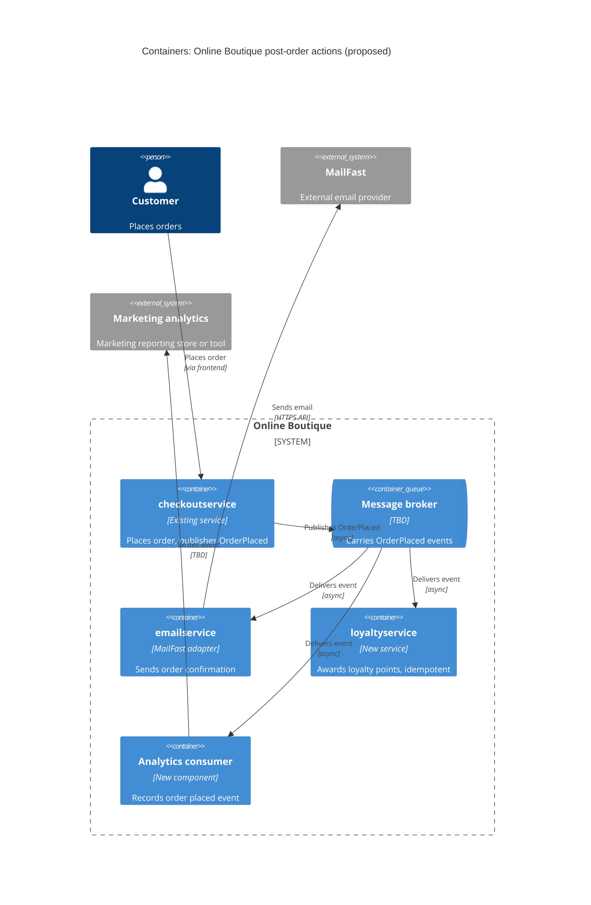

Agent: Claude Code. Model: Claude Opus 5.5 (claude-opus-5-5). Run: a (zero-shot, context: none).

# ADR-0002: Publish an "order placed" event to a message broker for post-order actions

- **Status:** Proposed
- **Date:** 2026-10-27
- **Deciders:** Not given in the requirement (see Open questions)

> No system files were in the allowed context. Every statement about the current Online Boutique architecture below is labelled **[Inferred]** or **[Assumption]** and comes from the requirement text or general knowledge, not from evidence in the repository.

## Context and problem

After an order is placed, Online Boutique must now trigger three actions (from the requirement):

| # | Post-order action | Owner / target | Nature |
|---|---|---|---|
| 1 | Send order confirmation email | **MailFast**, a new external email provider; replaces the mock `emailservice` logic | External, third-party call |
| 2 | Award loyalty points | New `loyaltyservice` (to be built) | Internal, state-changing |
| 3 | Record an "order placed" analytics event | Marketing team | Internal, data/reporting |

Marketing expects **more post-order actions next year**: SMS, fraud scoring and a recommendations update.

Current state:
- The requirement says `emailservice` holds "mock" logic today, so email is already a post-order step. **[Inferred]** The order-placing service (`checkoutservice` in Online Boutique) calls `emailservice` directly and synchronously over gRPC at the end of the order flow. Not evidenced in the provided files.
- **[Inferred]** No message broker exists in the system today. Not evidenced in the provided files.

Problem: how should the order-placing flow trigger a growing set of post-order actions? It must not put a slow or failing third party (MailFast) on the order path, and it must not require changes to the checkout code every time marketing adds an action.

## Decision drivers

Most important first. The order is my assumption; the requirement gives no priorities (see Open questions).

1. **Modifiability / extensibility:** adding SMS, fraud scoring and recommendations next year must not mean editing and redeploying the order-placing service for each one.
2. **Availability of order placement:** an outage or slowdown at MailFast (external), in `loyaltyservice` (new, unproven) or in analytics must not make placing an order fail.
3. **Performance (checkout latency):** post-order work should not add to the latency the customer sees when placing an order.
4. **Reliability of each action:** an email, loyalty award or analytics event should not be silently lost. Loyalty points in particular must not be awarded twice.
5. **Cost and operational complexity:** new infrastructure has to be run, monitored and understood by the team.
6. **Vendor independence:** the MailFast integration should sit behind one adapter so the provider can be replaced.

Note: fraud scoring (planned) may need to run **before** an order is confirmed, which is a different flow from "after the order is placed" (see Open questions).

## Considered options

1. **A: Direct synchronous calls from the order-placing service.** `checkoutservice` calls `emailservice` (rewritten as a MailFast adapter), `loyaltyservice` and an analytics endpoint one after another, as it calls email today.
2. **B: Publish an `OrderPlaced` event to a message broker (publish/subscribe).** `checkoutservice` publishes one event. `emailservice` (MailFast adapter), `loyaltyservice` and an analytics consumer each subscribe on their own. New actions add a subscriber.
3. **C: Dedicated post-order orchestrator service.** `checkoutservice` makes one call (fire-and-forget or a job queue) to a new `postorderservice`. That service calls email/MailFast, loyalty and analytics itself, with retries.

### Pros and cons of the options

| Option | Pros | Cons |
|---|---|---|
| A: Direct sync calls | No new infrastructure. Simple to follow and debug: one call chain. Immediate feedback when a step fails. Matches the current style **[Inferred]**. | Checkout latency grows with each call, MailFast latency included. Any failing dependency can fail or slow down checkout unless every call gets its own timeout/retry/ignore logic. `checkoutservice` must change and redeploy for each new action (SMS, fraud, recommendations). Tight coupling to every downstream service. No built-in retry or buffering: an email lost during a MailFast outage is lost for good. |
| B: Event + broker (pub/sub) | Checkout only publishes one event, so latency stays flat as actions are added. Downstream outages do not fail the order: the broker buffers events and consumers retry. New actions need no change to checkout (open/closed). Each consumer scales and fails independently. Analytics gets the same event stream other systems use. | Adds a broker to operate, monitor and secure (cost, ops skills). Eventual consistency: email and points arrive after a delay. Requires an event schema and versioning. Harder to trace end-to-end, so distributed tracing/correlation IDs are needed. At-least-once delivery means consumers (especially `loyaltyservice`) must be idempotent. Losing an event between "order saved" and "event published" is possible unless an outbox or equivalent is used. |
| C: Orchestrator service | Checkout is decoupled from individual actions with one call. All post-order logic, ordering and retries live in one place, which makes it easy to see what happens after an order. Can enforce ordering or dependencies between actions. No broker needed if the call is plain RPC. | The orchestrator becomes a new coupling point: every new action still means changing and redeploying it, so the modifiability problem moves rather than goes away. A single point of failure for all post-order actions. Without a queue it needs its own durable retry store, which means building half a broker. Tends to grow into a "god service". |

## Decision

**Choose Option B.** `checkoutservice` publishes an `OrderPlaced` event to a message broker after the order succeeds. Independent consumers subscribe:

- `emailservice`, rewritten as a **MailFast adapter**: it sends the confirmation email and isolates the vendor API behind it.
- `loyaltyservice` (new): awards points idempotently, keyed on order ID.
- An analytics consumer that records the "order placed" event for marketing.

Why: B is the only option that meets driver 1 (modifiability) for the known growth next year, since SMS and the recommendations update become new subscribers with no checkout change. It also meets drivers 2 and 3, because external and new services leave the order's critical path. Its costs fall on drivers 4 and 5 (idempotency, outbox, broker operations). These are manageable with standard patterns, while A and C carry structural costs that get worse with every new action.

The broker product (e.g. a managed cloud pub/sub, RabbitMQ or Kafka) is **not decided here**. It depends on hosting, expected volume and team skills, none of which are given (see Open questions).

## Consequences

- **Positive:** Adding SMS, recommendations or other post-order actions means adding a subscriber, with no change to `checkoutservice`. (quality attribute: modifiability / extensibility)
- **Positive:** MailFast, `loyaltyservice` or analytics outages no longer fail order placement; events wait in the broker and are retried. (quality attribute: availability)
- **Positive:** Checkout latency no longer includes the email/loyalty/analytics calls and does not grow with new actions. (quality attribute: performance)
- **Positive:** The MailFast integration sits behind `emailservice` alone, so changing provider affects one service. (quality attribute: modifiability, vendor independence)
- **Positive:** Each consumer scales independently with its own load. (quality attribute: scalability)
- **Negative:** A new broker must be provisioned, monitored, secured and paid for. (quality attribute: cost, operability)
- **Negative:** Confirmation emails and loyalty points arrive with a delay rather than at once, and the customer may see the order before the points. (quality attribute: consistency / usability)
- **Negative:** Following one order across several async consumers is harder. (quality attribute: observability / testability)
- **Negative:** Events become a contract that needs schema versioning across teams. (quality attribute: modifiability, interoperability)
- **Risks and mitigations:**
  - *Event lost between saving the order and publishing:* use a transactional outbox or publish-after-commit with retry. (reliability)
  - *Duplicate delivery (at-least-once) awards points twice or sends two emails:* idempotent consumers keyed on order ID. (correctness / reliability)
  - *MailFast rate limits or outages:* retries with backoff, a dead-letter queue, and alerts in the MailFast adapter. (availability)
  - *Poison messages block a consumer:* dead-letter queue per subscriber. (availability)
  - *Fraud scoring needs to block or hold an order:* it is out of scope for this async event. Decide it in a separate ADR as a synchronous pre-confirmation step, or as an async check with order hold/cancel. (correctness)
  - *Personal data (customer email) in events reaches analytics:* keep personal data out of the event payload, or restrict it per consumer. (security / privacy)
  - *Team has no broker experience:* prefer a managed broker and run a spike before committing. (cost, operability)

## Validation

- **Load test:** compare checkout latency before and after the change. Post-order work should add no measurable latency beyond the publish call. Target numbers not given (see Open questions).
- **Fault-injection test:** stop `loyaltyservice` and simulate a MailFast outage. Orders must still succeed, and the backlog must drain with no lost or duplicated points/emails once they recover.
- **Duplicate-delivery test:** replay the same `OrderPlaced` event. Points are awarded once.
- **Extensibility check:** add a stub SMS subscriber without changing `checkoutservice`.
- **Metrics in production:** consumer lag, dead-letter queue size, MailFast send success rate, and the share of orders with email sent / points awarded / analytics recorded.
- **Review date:** before the first of next year's actions (SMS, fraud scoring, recommendations) is built. Date not given.

## Open questions

- Who are the deciders and owners (checkout team, marketing, the team building `loyaltyservice`)?
- How does `checkoutservice` call `emailservice` today, and what does the order flow look like? Not evidenced in the provided files (no context files allowed).
- Order volume, peak load and checkout latency targets? None given.
- Required delivery time for confirmation emails and loyalty points (seconds, minutes)? Is any delay acceptable?
- MailFast API details: protocol, rate limits, SLA, pricing, webhooks for bounces/delivery status, data-residency terms?
- Should a MailFast failure ever be visible to the customer, or is "retry later" enough?
- Hosting platform and existing infrastructure: is a managed broker available? Which broker is acceptable?
- Team skills and capacity for running a broker and async systems?
- Does `loyaltyservice` need its own data store? Must points be consistent with order cancellations or refunds?
- Where does marketing's analytics data go (tool, warehouse, format), and what fields does it need?
- Must fraud scoring run before order confirmation? If so it needs a separate synchronous decision.
- Delivery guarantees needed per action (at-least-once acceptable? any exactly-once requirement)?
- Privacy rules for customer personal data (email address, order contents) in events?
